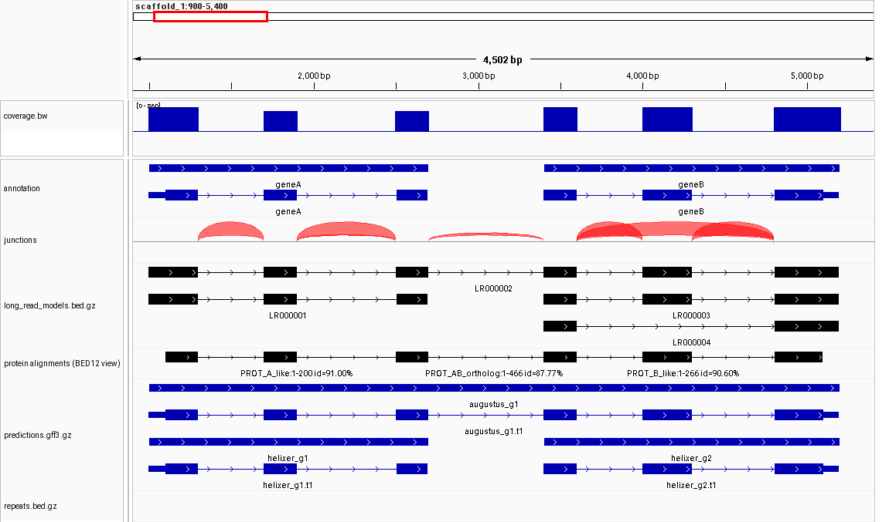
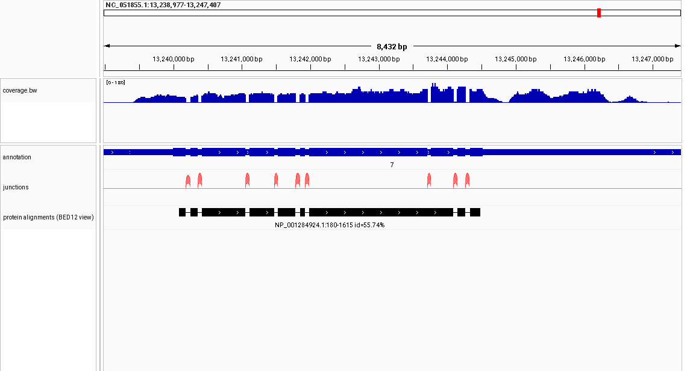

# annotation-evidence

> **Genome annotations are small. The evidence that produced them often isn't.**

A modern genome annotation may rest on hundreds of gigabytes to terabytes of RNA sequencing, protein alignments and
intermediate gene predictions, yet the file people actually download is a few megabytes of GFF3. Once it is distributed, the
reasoning behind an individual gene model is hard to reconstruct: *Are these introns independently supported? Is this transcript
seen in long reads? Do two adjacent genes look like one? Was this region called from experimental evidence or from an ab initio
predictor?*

This project explores whether annotation pipelines could also emit a small, standardised **evidence bundle** — a compact
"evidence shadow" that keeps enough of the observations behind an annotation to inspect and challenge individual gene models later,
with ordinary genomics tools (`tabix`, `bedtools`, a genome browser) or with a script or language model.

**Status: a proposal and a working prototype (spec v0.1, draft). It is not an established standard, nothing has been adopted
by anyone, and it has been tested on one small real dataset per component, not on a full genome.**

## A concrete sense of scale

One recent NCBI RefSeq annotation of the moth *Helicoverpa armigera* (release `GCF_030705265.1-RS_2024_03`, listing read 2026-09-25):

| | Size |
|---|---|
| RNA-seq behind it: 145 SRA runs, 140 BioSamples, 16 BioProjects | **8.2 billion reads, 1.17 Tbp** |
| The annotation, `genomic.gff.gz` | **6.3 MB** |
| Same-species transcript alignments (GFF3), published by NCBI | 50 MB |
| One RNA-seq coverage bigWig per run, published by NCBI | **145 files, 10.3 GB** |
| Protein-to-genome alignments; a collapsed splice-junction table | not in the release directory |

NCBI publishes more evidence than many projects do, and EGAPx keeps evidence internally as NCBI-specific ASN.1. But for a typical
non-model genome, what survives is the GFF3. (Details and sources: [docs/RESEARCH_NOTES.md](docs/RESEARCH_NOTES.md).)

## What a bundle holds

```text
bundle/
├── manifest.yaml                    provenance: sources, programs, versions, databases, filters, checksums
├── annotation.gff3.gz               the annotation being explained
├── assembly_sequences.tsv           sequence names and lengths (+ GA4GH refget digests), so names cannot drift
├── samples.tsv                      one row per library, with tissue/stage group
└── evidence/
    ├── rna_junctions.tsv.gz         splice junctions collapsed across libraries (sample count, group count, read stats)
    ├── long_read_models.bed.gz      long-read transcript structures (BED12 + counts), collapsed by intron chain
    ├── protein_alignments.gff3.gz   protein-to-genome alignments (GFF3, with protein-side coordinates)
    ├── predictions.gff3.gz          ab initio / HMM gene predictions, tagged by program
    └── coverage.bw                  optional: merged, quantised RNA-seq coverage (bigWig)
```

BED, BED12, GFF3, bigWig, bgzip + tabix and one small TSV. Each format's coordinate convention (0- or 1-based, open or closed) is stated
explicitly and unit-tested. Full definition: [docs/SPECIFICATION.md](docs/SPECIFICATION.md); why these formats:
[docs/DESIGN_RATIONALE.md](docs/DESIGN_RATIONALE.md).

## Provenance without bulk

This is the central trade-off, so it is stated plainly. An evidence bundle is **not** a replacement for SRA, raw FASTQ, BAM/CRAM, the
complete annotation workflow, or full archival provenance. It sits between two extremes:

```text
GFF3 only  ──────────  evidence bundle  ──────────  the complete multi-terabyte annotation project
 (tiny, opaque)      (compact observations that       (everything, but rarely kept
                      explain the structure)            or re-runnable)
```

It preserves a compact set of *observations* — "this intron is crossed by uniquely mapping reads in 14 of 20 libraries from 5 tissues",
"one long read joins these two genes", "this protein aligns across both" — plus the **filters that decided what was kept**, because a
missing record can only be interpreted if you know what was removed. The aim is a bundle within tens (not thousands) of times the size of
the annotation. Measured on real data, the junction, long-read, protein and prediction tables are small; **coverage is the expensive part**,
which is why it is optional and should be merged and quantised (two to three orders of magnitude smaller than the alignments;
see the design rationale for the measurements).

## Try it in two minutes

```bash
git clone https://github.com/Andy-B-123/2026_ComBio_AnnotationEvidence.git && cd 2026_ComBio_AnnotationEvidence
pip install pyyaml jsonschema pytest                # PyYAML is the only runtime dependency; htslib (tabix) is optional but recommended
python scripts/validate_bundle.py examples/minimal/bundle
python scripts/query_region.py    examples/minimal/bundle scaffold_1:2500-3500
python scripts/summarise_gene.py  examples/minimal/bundle geneA
python -m pytest tests
```

New here? Read [docs/USER_GUIDE.md](docs/USER_GUIDE.md): what the pipeline expects, the exact commands, what comes out, and how to look at it.

`summarise_gene.py` reports, for each intron: an exact match per evidence class, the classes that exist but have no match, and any
*competing* junction. An excerpt for `geneA` in the synthetic example:

```text
### Intron 2: 1901-2500 (600 bp)  ->  supported
- rna_short: exact match. 8 sample(s) / 3 group(s); unique reads total 154, max in one sample 28, median 19.5; ...
- rna_long: exact match in 2 model(s) with 84 read(s) ...
- competing junction 1901-2490 (alt_acceptor, shift -10 bp): 3 sample(s)/3 group(s), 4 unique reads, 2.6% of the annotated junction's unique reads.
...
## Evidence spanning this gene and a neighbouring annotated gene
- rna_long: 1 model(s) (75 reads) touch only one gene; 1 model(s) (9 reads) span several genes.
  - PA000002 (PROT_AB_ortholog, 466 aa, identity 87.77%): geneA: aa 1-200; geneB: aa 201-466
- rna_short junction 2701-3400 joins an exon end of geneA to an exon start of geneB: 4 sample(s), 3 group(s), 10 unique reads (max 4).
  This is a REASON TO LOOK CLOSER (...), not a finding that the models are wrong. ...
```

The synthetic example ([examples/minimal](examples/minimal)) has two adjacent genes annotated separately, where one long-read model, one
protein alignment and a few junctions span both. That is a *possible* split gene, and the bundle shows it **without claiming the
annotation is wrong**: the tools keep *support*, *absence of retained evidence* and *competing evidence* apart, and
[docs/LLM_GUIDE.md](docs/LLM_GUIDE.md) tells an agent exactly how to do the same.

## See it

Rendered in IGV straight from a bundle (`export_browser_tracks.py` + `igv_snapshot.sh`). Synthetic example: two genes annotated separately, with a
10-read junction, a long-read model and a protein spanning both (the thin flat arc), against evidence that covers each gene on its own:



Real public data (six *Hermetia illucens* RNA-seq libraries, the RefSeq annotation, *Drosophila* proteins aligned with miniprot): nine introns, nine junction arcs,
protein blocks matching the coding exons:



## What has and has not been checked

* **Tests:** 164 automated tests (Python 3.9 and 3.13): coordinate conversions, `tabix` against a pure-Python scan at every record boundary, negative tests for the
  validator, every producer script, and the tools run on the example. The coordinate and logic tests were checked by deliberately injecting bugs (each caught by a specific
  test; several gaps found this way were closed).
* **Real public data:** on one chromosome of *Hermetia illucens* (six ENA RNA-seq libraries, the RefSeq annotation, *D. melanogaster* proteins):
  * junctions from STAR agree with RefSeq introns exactly (6 510 of 7 803, 83.4 %) and **0.0 %** after any one-base shift, so STAR's introns and GFF3 introns are the same objects;
  * `bam_to_junctions.py` reproduces STAR's own `SJ.out.tab` **exactly** (strand, motif, unique, multimapper and overhang) for every STAR junction in all six libraries;
  * the whole pipeline (`examples/pipeline_template.sh`) builds a validated 1.4 MB bundle from 408 MB of BAM in about a minute, and the bundle loads and renders in IGV 2.19.8.
* **Scope for now:** STAR alignments, minimap2 + bedtools long reads, miniprot proteins. Other tools can be added later.
* **Not checked:** JBrowse2 and the UCSC browser; a whole-genome bundle; STAR's default output filters (not emulated: BAM-derived junctions are unfiltered).

## What remains open

* **Which samples supported a junction.** Only counts survive collapsing, by design: this keeps the format small and simple.
* **Coverage** is deliberately basic: merged, quantised, not strand-specific. Better recipes (per-tissue tracks, strand) are welcome.
* **Thresholds** (`min_reads`, `min_samples`, the "dominant competing junction" rule) have minimal, always-recorded defaults; sensible values depend on depth and clade, and real
  long-read data contain many models supported by a single read.
* **Single-exon long-read models** are clustered by start and end within a tolerance and counted, but kept apart from spliced evidence; how best to weigh them is an open question.
* **Standards.** GA4GH has BED and refget (both used) but only a study group on annotation; whether this belongs there or in an RO-Crate wrapper is open.

## Skill and MCP

[skill/SKILL.md](skill/SKILL.md) is a short, vendor-neutral prototype for a coding-agent skill (explain a gene, build a bundle, compare two models).
[docs/FUTURE_MCP.md](docs/FUTURE_MCP.md) sketches an access layer; **no server is built**. An MCP server would only be worth building once there are
several real bundles from different pipelines, a stable spec (1.0), reference scripts validated on full-genome annotations, and evidence that people
or agents actually ask these questions of them. The bundle must stay useful without any of it.

## Repository

```text
docs/        USER_GUIDE.md  SPECIFICATION.md  DESIGN_RATIONALE.md  RESEARCH_NOTES.md  LLM_GUIDE.md  FUTURE_MCP.md  img/
schema/      manifest.schema.yaml  manifest.template.yaml  rna_junctions.md  long_read_models.as
scripts/     bam_to_junctions  aggregate_star_junctions  collapse_long_reads  miniprot_to_evidence  make_coverage   (producers)
             make_manifest  validate_bundle                                                                          (provenance, conformance)
             query_region  summarise_gene  export_browser_tracks  igv_snapshot.sh                                    (reading, viewing)
             evidence_common.py                                                                                      (shared code, incl. coordinates)
examples/    minimal/  synthetic bundle, raw inputs, generator, build.sh, competing model     pipeline_template.sh  (build your own bundle)
skill/       SKILL.md
tests/       pytest suite and small real-data fixtures
```

Requirements: Python ≥ 3.9 and PyYAML. Optional: htslib (`bgzip`, `tabix`) to write and index files and for fast region queries; samtools and bedtools for BAM-based steps;
miniprot for proteins; `jsonschema` for manifest validation; `pyBigWig` or UCSC `bigWigToBedGraph` to read coverage and `bedGraphToBigWig` to write it; IGV to look at a bundle.

## Licence, contributing, citation

MIT licence ([LICENSE](LICENSE)); see [CONTRIBUTING.md](CONTRIBUTING.md). Example data are synthetic; test fixtures come from public
sources listed in [tests/data/README.md](tests/data/README.md). There is no paper and no DOI yet; if you use the idea, please link this repository.

## About this repository

The specification, scripts, tests and documentation in this repository were generated with [Claude Code](https://claude.com/claude-code),
under the direction and iterative review of Andy Bachler (CSIRO), who set the design requirements, made every design and scope decision recorded
in the docs, ran and reviewed the validation against real public data, and takes ownership of all decisions made and any errors that remain.
If you find a mistake, please open an issue.
