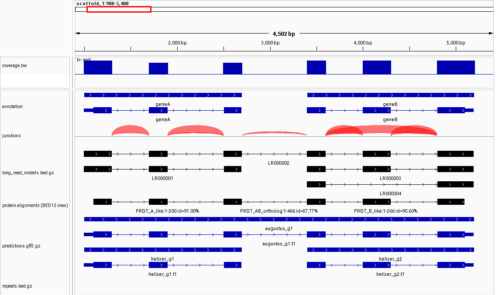
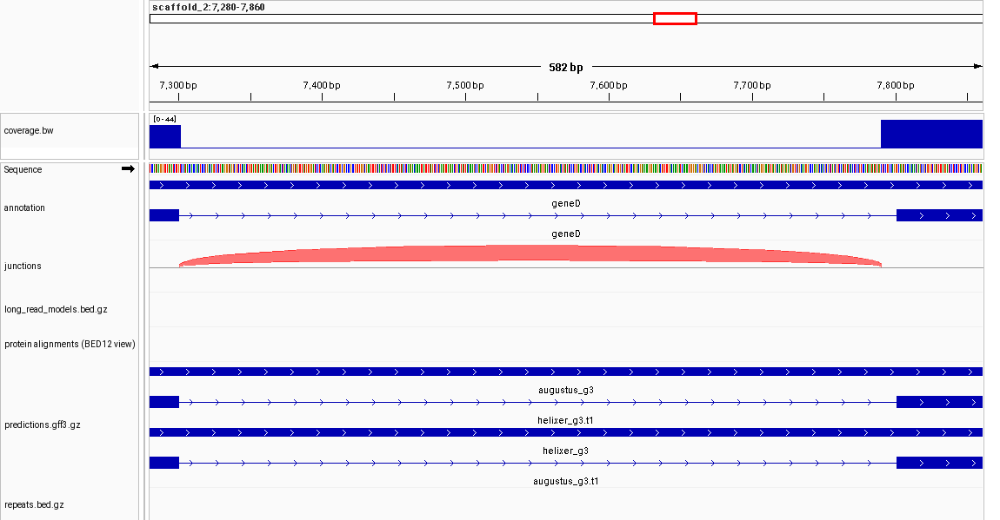
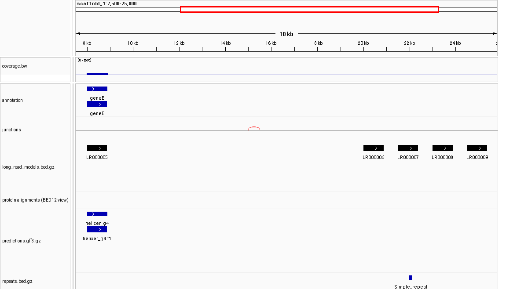
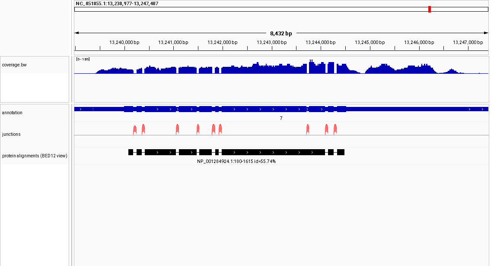
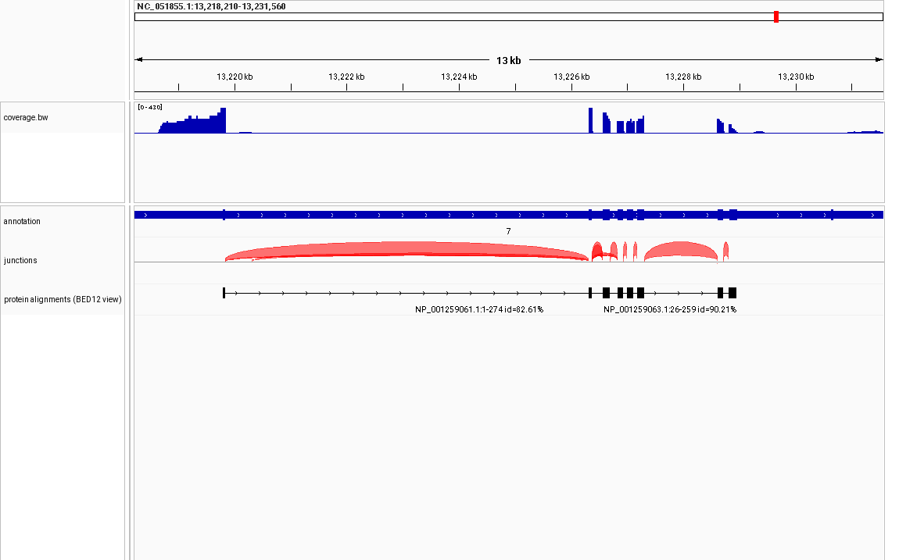

# User guide: making, checking and looking at an evidence bundle

This guide takes you from an annotation you already have to a validated bundle you can query and look at. For the file
definitions see [SPECIFICATION.md](SPECIFICATION.md); for how to *interpret* what you find, see [LLM_GUIDE.md](LLM_GUIDE.md).
Everything below was run on real public data (see "What a real run looks like").

## 1. What you need

| Input | What it must be | Used by |
|---|---|---|
| **Assembly FASTA** | the exact assembly the annotation and the alignments refer to | `make_manifest.py sequences`; motifs in `bam_to_junctions.py` |
| **Annotation GFF3** | the annotation you want to explain: `gene` → `mRNA`/transcript → `exon` (+ `CDS`), unique `ID`s. Plain or gzip | the bundle's `annotation.gff3.gz` |
| **Short-read RNA-seq** (recommended) | either **coordinate-sorted BAMs** from STAR (also EGAPx's STAR BAMs), one per library, **with `NH` tags and secondary alignments kept**, or STAR `SJ.out.tab` tables | `bam_to_junctions.py`, `aggregate_star_junctions.py` |
| **Long-read RNA-seq** (optional) | one alignment BAM per library (e.g. `minimap2 -ax splice`), sorted, indexed | `samtools` + `bedtools bamtobed -bed12`, `collapse_long_reads.py` |
| **Proteins** (optional) | a protein FASTA, or the output of `miniprot --gff` (it must contain the `##PAF` lines, so not `--gff-only`) | `miniprot`, `miniprot_to_evidence.py` |
| **Ab initio predictions** (optional) | GFF3 from AUGUSTUS, Helixer, GeneMark, ...; column 2 = the tool's tag | copied and indexed |
| **`samples.tsv`** | one row per library with a `group` (tissue/stage). Template columns in the spec, section 4 | group counts, manifest |
| **Provenance you write** | data sources, tool versions, parameters, why a class is absent: copy [`schema/manifest.template.yaml`](../schema/manifest.template.yaml) | `make_manifest.py build` |

Sequence names must be the same everywhere. EGAPx's internal files call a sequence `lcl|NC_...` while its final GFF3 uses `NC_...`;
pass `--strip-prefix 'lcl|'` (or `STRIP_PREFIX` in the template) and the bundle uses the plain name.

## 2. Install

* Python ≥ 3.9 and PyYAML (`pip install pyyaml`). `pip install jsonschema` for manifest validation, `pytest` to run the tests.
* **htslib** (`bgzip`, `tabix`): needed to write and index files, and it makes region queries fast. Everything reads without it.
* **samtools** (reads BAM for `bam_to_junctions.py`), **bedtools** (long reads, coverage), **miniprot** (proteins).
* Optional: UCSC `bedGraphToBigWig` (bigWig coverage; otherwise you get a `.bedgraph.gz`), `bigWigToBedGraph` or `pyBigWig` (read coverage back),
  **IGV** (look at a bundle; Section 6).

## 3. The fast way: one script

[`examples/pipeline_template.sh`](../examples/pipeline_template.sh) is the whole recipe as a top-to-bottom shell script. Every step runs only if its
input variable is set:

```bash
OUT=my_bundle GENOME=genome.fa ANNOTATION=annotation.gff3 SAMPLES=samples.tsv PROVENANCE=provenance.yaml \
SHORT_BAMS="S1=/data/S1.bam S2=/data/S2.bam S3=/data/S3.bam"  PROTEINS_FASTA=proteins.faa PROTEINS_DB="UniRef90 Insecta" PROTEINS_TAXID=6960 \
LONG_BAMS="L1=/data/L1.bam L2=/data/L2.bam"  COVERAGE=yes  STRIP_PREFIX='lcl|'  THREADS=8  MIN_TOTAL_UNIQUE=3 \
    bash examples/pipeline_template.sh
```

Filters (`MIN_TOTAL_UNIQUE`, `MIN_SAMPLES`, `LONG_MIN_READS`, `PROTEIN_MIN_COVERAGE`, `LONG_MAPQ`) have minimal defaults and are recorded in the
manifest. It stops at the first error and ends by running the validator.

## 4. Step by step (what the script does)

**1. Sequence table and samples.** `make_manifest.py sequences --fasta genome.fa -o bundle/assembly_sequences.tsv` writes name, length and a GA4GH refget digest for every sequence.

**2. Annotation.** Sorted by sequence and start, bgzip-compressed, tabix-indexed.

**3. Short-read junctions.**
```bash
bam_to_junctions.py S1.bam --fasta genome.fa -o star/S1.SJ.out.tab          # one per library; skip if you already have STAR's SJ.out.tab
aggregate_star_junctions.py --samples samples.tsv --min-total-unique 3 -o bundle/evidence/rna_junctions.tsv.gz star/*.SJ.out.tab
```
`bam_to_junctions.py` reproduces STAR's own `SJ.out.tab` **exactly** (identical strand, motif, unique, multimapper and overhang values for every
STAR junction in six real libraries), but it is **unfiltered**: STAR applies `--outSJfilter*` before writing, so a BAM-derived table has many more
low-support junctions. That is why the guide uses `--min-total-unique 3`. Pick your own thresholds; the manifest records them.
This route is what you need for **EGAPx**, which runs STAR with `--outSJtype None`: use the STAR BAMs from the run's work directory
(`nextflow/run.trace.txt`, task `run_star`; keep the work directory) and `--strip-prefix 'lcl|'`.

**4. Long reads.**
```bash
samtools view -b -F 0x900 -q 20 L1.bam | bedtools bamtobed -bed12 -i - > L1.bed12          # primary alignments, MAPQ >= 20
collapse_long_reads.py --samples samples.tsv -o bundle/evidence/long_read_models.bed.gz L1.bed12 L2.bed12
```
Reads with the same intron chain become one model. **Single-exon reads are kept**, clustered by start and end (`--single-exon-tolerance 50`), and counted; they
are reported separately from spliced models because they may be fragments, unspliced RNA or genuine single-exon genes. Use `--min-reads 2` to drop models seen once.

**5. Proteins.**
```bash
miniprot -It8 --gff genome.fa proteins.faa | miniprot_to_evidence.py --db "UniRef90" --taxid 6960 --aligner-version 0.18 \
    --min-pct-coverage 40 -o bundle/evidence/protein_alignments.gff3.gz
```
Only rank-1 alignments are kept by default (`--max-rank 0` keeps all).

**6. Predictions, repeats.** Sorted, compressed, indexed as they are.

**7. Coverage (optional, the largest part).**
```bash
make_coverage.py --sequences bundle/assembly_sequences.tsv -o bundle/evidence/coverage.bw S1.bam S2.bam S3.bam
```
Sums spliced depth over the BAMs, snaps it to a geometric ladder (about 19 % steps) and writes a bigWig, or a bedGraph if the name ends `.bedgraph.gz`.
`--window 50` averages in 50-bp windows (smaller still), `--unique-only` ignores multimappers, `--ladder 0` keeps exact depths. Basic by design: not strand-specific.

**8. Manifest and validation.**
```bash
make_manifest.py build bundle/ --template provenance.yaml --fasta genome.fa --summary rna_short=agg.json --summary rna_short=b2j_S1.json ...
validate_bundle.py bundle/
```
`--summary` takes the `--summary-json` files that the producer scripts write, so the filters and counts in the manifest are never typed by hand.
The validator exits 0 only if the bundle conforms; it names the file and line of any problem.

## 5. What comes out

A real run on public data (chromosome NC_051855.1 of *Hermetia illucens*; six ENA RNA-seq libraries totalling 408 MB of BAM; the RefSeq annotation; 30 802
*Drosophila melanogaster* RefSeq protein isoforms) took **52 seconds** and produced a **1.4 MB** bundle:

```text
manifest.yaml                        6.7 KB   provenance, filters, checksums, per-step statistics
samples.tsv, assembly_sequences.tsv  <1 KB
annotation.gff3.gz (+.tbi)           238 KB   RefSeq annotation of the chromosome (the bundle's own copy)
evidence/rna_junctions.tsv.gz        28.6 KB  2,017 junctions from 21,691 per-library rows
evidence/protein_alignments.gff3.gz  129 KB   1,366 alignments (of 2,597; rank 1, coverage >= 40 %)
evidence/coverage.bw                 954 KB   merged, quantised coverage of all six libraries
```

Each file is described in the specification; a manifest excerpt shows what a reader gets without opening anything else:

```yaml
evidence:
  rna_short:
    present: true
    programs: [STAR, aggregate_star_junctions.py, bam_to_junctions.py]
    filters: {min_sample_unique_reads: 1, min_samples: 1, min_total_unique_reads: 3, min_unique: 0, min_total: 1, min_overhang: 0, star_outSJfilter: not applied}
    stats:
      bam_to_junctions.py: {junctions_seen: 21691, junctions_written: 21691, noncanonical: 1492, ...}       # summed over the six libraries
      aggregate_star_junctions.py: {input_rows: 21691, distinct_junctions_before_filters: 4308, output_rows: 2017, ...}
    outputs: [{file: evidence/rna_junctions.tsv.gz, format: rna_junctions, records: 2017, bytes: 28647, sha256: ...}]
```

## 6. Looking at a bundle

**Text.** `query_region.py bundle/ scaffold_1:2500-3500` shows everything overlapping a region; `summarise_gene.py bundle/ GENE` gives per-intron support, absence
and competing junctions, single-exon models, cross-gene evidence (add `--format json` for a machine-readable version; `--annotation other.gff3` scores a competing model).

**IGV.** Most bundle files load in IGV directly. Two are converted, because IGV cannot draw them as they are:

```bash
export_browser_tracks.py bundle/ bundle/browser --genome genome.fa --locus scaffold_1:900-5400   # -> junctions.bed, protein_alignments.bed, igv_session.xml
# open bundle/browser/igv_session.xml in IGV (File > Open Session), or render a PNG without a screen:
IGV=/path/to/IGV_Linux_2.19.8 scripts/igv_snapshot.sh bundle/browser/igv_session.xml scaffold_1:900-5400 figure.png
```

What IGV showed (all five images were produced with those two commands, IGV 2.19.8, headless):

*Synthetic example: two genes annotated separately, with evidence spanning both.* Coverage on top; the thin, flat arc joining the genes is a 10-read
junction, the fat arcs are each gene's own introns, the tall one is a 100-read exon skip; one long-read model and one protein span both genes, others cover
one; AUGUSTUS calls one gene, Helixer two.



*Synthetic example: competing evidence.* The RNA junction ends at the acceptor 10 bp upstream of the annotated one, and coverage steps up there; the annotation and both predictors start ten bases later.



*Synthetic example: single-exon models.* geneE is a single-exon gene supported by a long-read model (20 reads, 3 libraries) and a predictor; four unannotated single-exon loci follow, one overlapping a repeat.



*Real data: a well-supported gene.* Nine RefSeq introns each carry a junction arc; the fly protein's blocks match the coding exons; coverage follows the exons.



*Real data: a mixed picture.* A long first intron with a heavy arc, proteins matching the exon structure at 82–90 % identity, and coverage that fades toward the 3′ end: the last annotated exon of one transcript has no junction, protein or coverage support in these libraries (which says nothing yet about whether it is real).



Notes from testing in IGV: the junction BED uses the TopHat junction format (a `track name=junctions` header) because IGV then draws it as a native splice-junction
track with arc height proportional to read count; a GFF3 `protein_match` with `match_part` children is drawn as one unbroken bar, hence the BED12 view; a
dense real annotation should not be "expanded" (`IGV_EXPAND` in the helper), because IGV can allocate a huge blank area. JBrowse2 and the UCSC browser were not tested.

## 7. What the pipeline assumes

* Short-read BAMs are **coordinate-sorted** and carry `NH` tags; multimappers appear as secondary alignments. Read pairs are counted once per junction.
* Junction strand and motif come from the genome sequence (as in STAR), not from library strandedness; coverage is not strand-specific.
* Long-read alignments are filtered to primary alignments with a MAPQ threshold *before* collapsing, and that choice belongs in the manifest.
* The annotation is a hierarchical GFF3; genes and transcripts are found by `ID`/`Name`/`gene`/`locus_tag`.
* Proteins come from `miniprot --gff` (with `##PAF` lines). Other aligners are not supported yet.
* Everything is one assembly. Coordinates are checked against `assembly_sequences.tsv`.

## 8. When something goes wrong

| Symptom | Likely cause and fix |
|---|---|
| `seqid 'lcl|NC_..' is not in assembly_sequences.tsv (it is an alias of ...)` | strip the prefix: `--strip-prefix 'lcl|'` in every producer |
| `... not found in the FASTA and skipped` from `bam_to_junctions.py` | BAM and FASTA names differ; use `--strip-prefix`, or the wrong assembly |
| `samtools is needed to read BAM/CRAM` | install samtools, or pipe SAM text: `samtools view -h x.bam \| bam_to_junctions.py - ...` |
| `input declares SO:coordinate but a reference reappears` | the BAM is not really sorted; `samtools sort` it |
| `no_query_length` warning from the protein converter | miniprot was run with `--gff-only`; rerun with `--gff` |
| validator: `not sorted by start` | a hand-made file is unsorted; `sort -k1,1 -k2,2n` (BED/TSV) or `-k4,4n` (GFF3) before `bgzip` and `tabix` |
| validator: `sample_count > n_samples` / `group_count > sample_count` | the table was edited by hand or built from a different samples file |
| `tabix failed` | the index is stale after editing a file; rebuild it with `tabix -f -p gff\|bed` or `-s1 -b2 -e3` |

## 9. Time and memory (measured, one chromosome)

`bam_to_junctions.py`: 1.7 s and 33 MB for a 44 MB BAM; 5 s and 42 MB for a 127 MB BAM (memory is bounded by one sequence for a coordinate-sorted BAM).
`make_coverage.py`: 33 s for six BAMs (408 MB). `miniprot` with 8 threads: 36 s for 30 802 proteins against 15 Mb. These are single-chromosome figures; a whole-genome run has not
been done, so treat them as per-chromosome scaling hints only.
